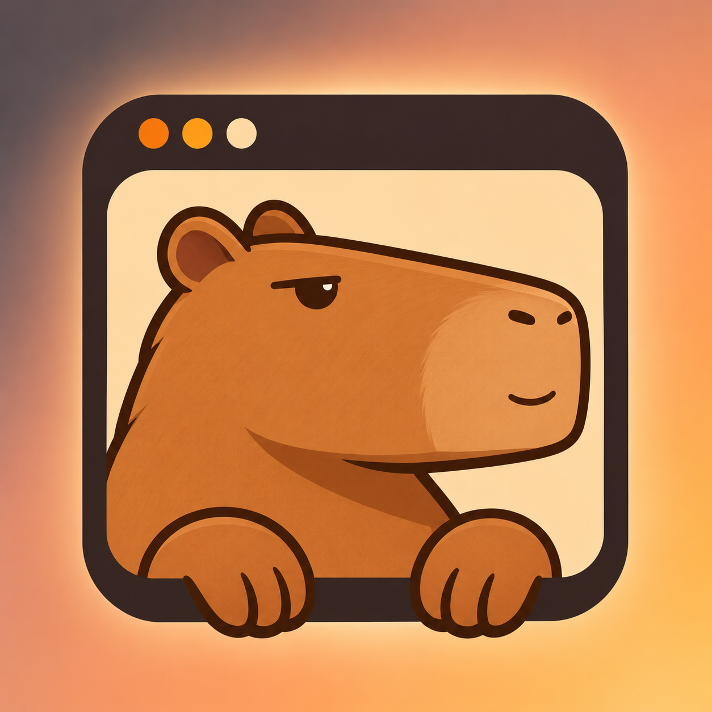

# CapyScreen

A capybara-only meme discovery site with live search, GIFs, templates and a private browser collection.

Run locally with `node tools/serve.cjs`, then open http://127.0.0.1:8000. No build or server dependencies are required.

Discovery searches Lemmy, Reddit, Bluesky and Mastodon for capybara/capy. Tenor, Giphy and Imgur work with optional user API keys. A shared metadata/community filter rejects unrelated content across all result streams and the local library. This is metadata filtering, not image recognition. Four locally bundled capy posts are available while live services load.

CapyScreen uses separate browser storage, preserving the previous DogeScope library. The old token announcement and social links are not part of this brand.

Third-party meme source URLs are retained in data/memes.json. Keep LICENSE and NOTICE with redistributions.
